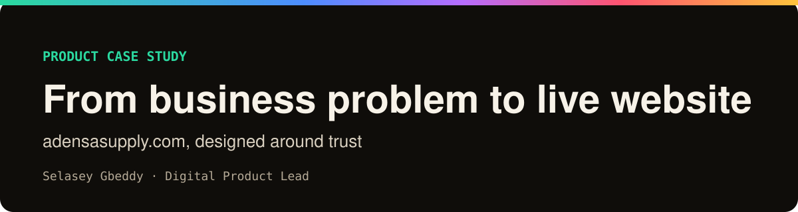
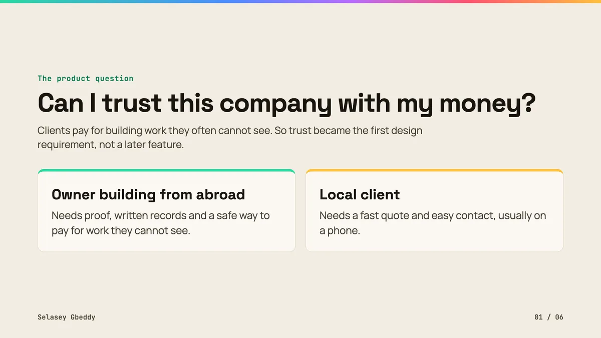

## Can I trust this company with my money?

That question shaped everything.

Clients abroad pay for work they cannot see. Local clients want a quote, fast.

Ten problems became one clear website. Designed in Figma. Live today.

Design artefacts only. This repository holds no website source code. <a href="https://selasey-gbeddy.vercel.app">Portfolio</a> · <a href="https://www.figma.com/@selaseyjr">Figma</a>

