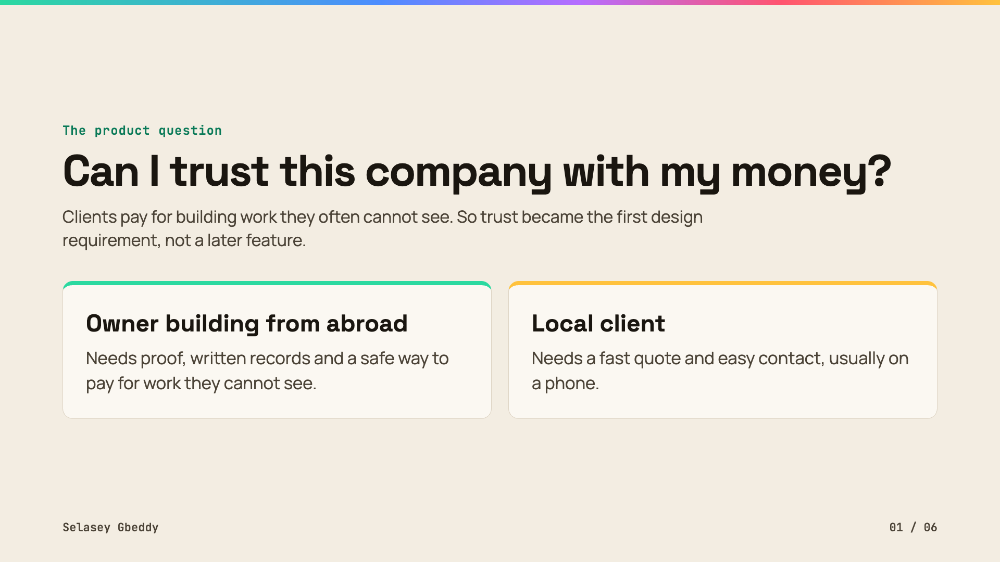
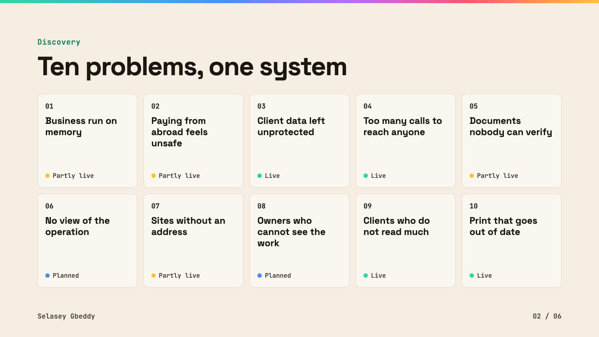
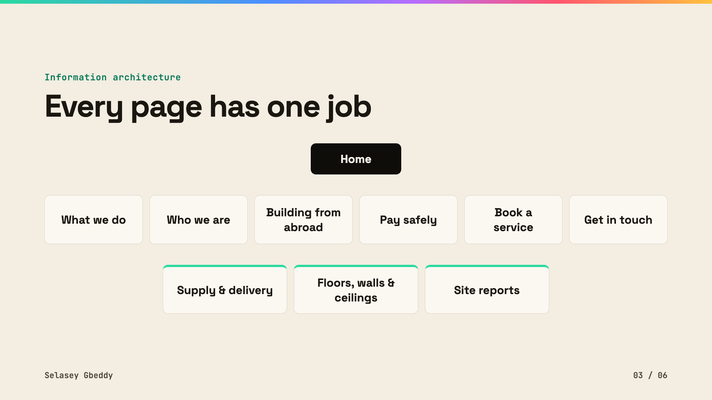
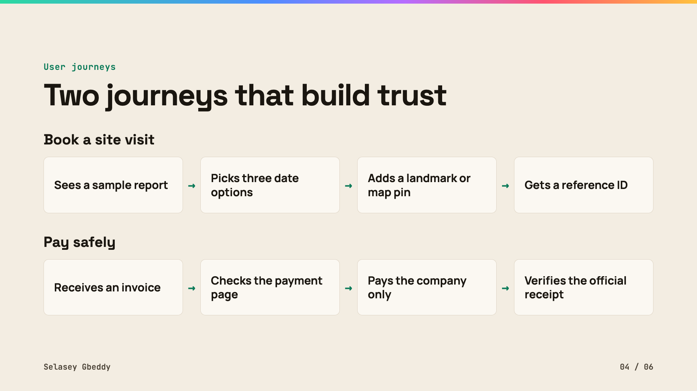
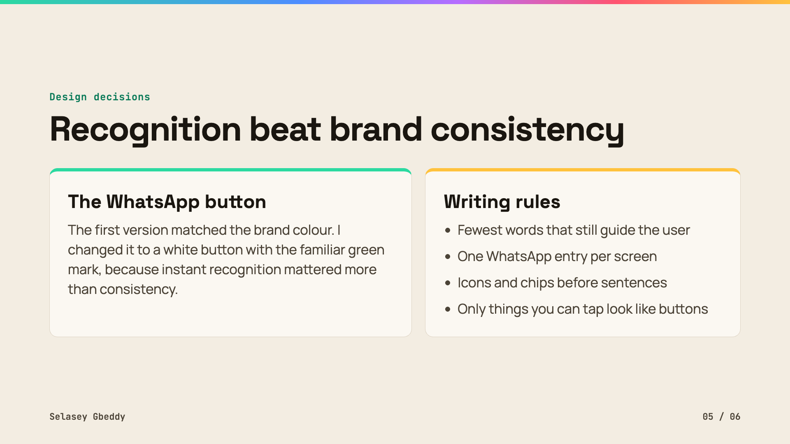
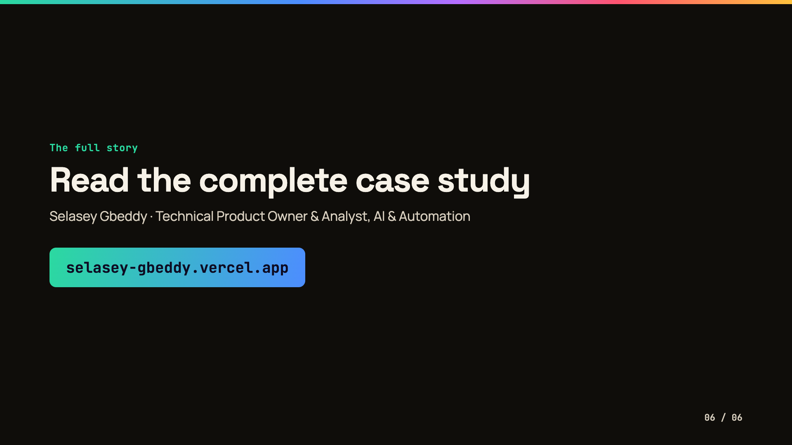

## Can I trust this company with my money?

That question shaped everything.

Ten problems. One system. A live website.

<table>
<tr><td width="50%"> The product question</td><td width="50%"> Discovery: ten problems, one system</td></tr>
<tr><td width="50%"> Information architecture</td><td width="50%"> User journeys</td></tr>
<tr><td width="50%"> Design decisions</td><td width="50%"> The full story</td></tr>
</table>

Design artefacts only. This repository holds no website source code. <a href="https://selasey-gbeddy.vercel.app">Portfolio</a> · <a href="https://www.figma.com/@selaseyjr">Figma</a>

